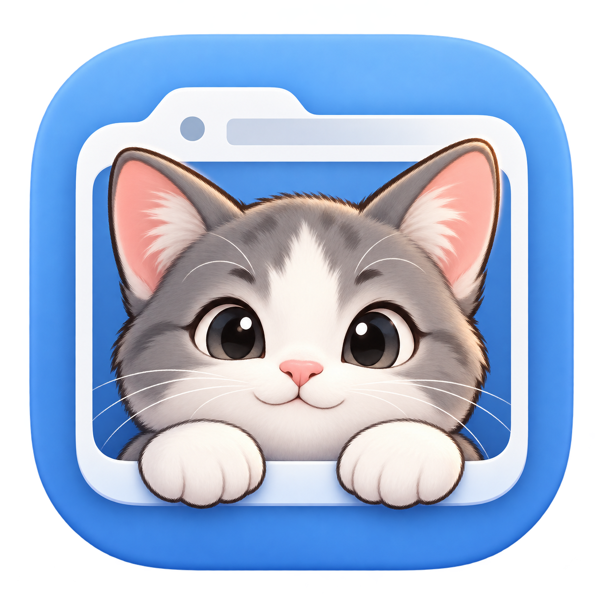

# BrowserPet



Mac 桌宠找页工具。点击小猫或按 **Control + Option + Space**，搜索 Chrome、Safari、Edge 当前打开的页面，一键切回原标签页。

[下载 macOS 安装包](https://github.com/kudoushinichiYu/BrowserPet/releases/latest) · [版本说明](docs/releases/v0.4.0.md)

## 安装与使用

需要 **Apple Silicon（arm64）、macOS 13+**；Safari 助手需要 **Safari 18.4+**。打开 DMG，将 `BrowserPet.app` 拖到“应用程序”后启动。安装包无需 Python、Node 或 Xcode。

当前个人测试版为 **ad-hoc 签名，未使用 Developer ID、未经 Apple 公证**。首次下载可能被 macOS 阻止，或需要在系统设置中审查打开许可；组织策略不允许时可从源码构建。请勿关闭系统安全防护。

- 唤出后直接输入标题、网址或域名，上下选择，Enter 切换，Esc 收起。快捷键可在设置修改。
- 顶部可筛选浏览器；默认保留已连接的 Chrome 原组，未分组页面按用途归类，也可切换网站、窗口视图。
- 结果为紧凑单行。长标题用省略号，悬停后往返滚动；站点和窗口号悬停可看详情。同标题、同网址页面分别保留。
- 小猫支持拖动、记住位置、隐藏；右键打开搜索、设置或退出。隐藏后菜单栏爪印和快捷键仍可用。
- 小猫空闲保持静止并停止动画计时器；悬停和等待/错误反馈只播放一轮，拖动、实际读取/切换时保留动画，搜索时可随输入方向注视。
- “项目工作集与清理”：从搜索框右侧收纳图标或小猫右键菜单打开，保存项目链接、归档关闭并按需恢复。
- 开启系统“减少动态效果”时使用静态猫并停用标题滚动。登录启动可在设置注册，最终状态由 macOS 决定。

## 浏览器连接

### Chrome 与 Edge

运行浏览器后，首次搜索按 macOS 提示授予各自的自动化权限。基础搜索和切换无需扩展，不需要“允许 Apple Events 执行 JavaScript”、屏幕录制或辅助功能权限。应用不会为扫描启动尚未运行的浏览器。

支持同一浏览器实例的多个普通窗口及 Profile，独立 `user-data-dir` 或其他实例不保证覆盖。Chrome 已做本机运行验收；Edge 已实现且通过脚本契约测试；后续本机已发现安装，本轮仍未完成 Edge 实机验收。Firefox 尚未接入。

### Chrome 原有分组

1. 先将应用安装到“应用程序”，在面板点击“连接原分组”。按钮注册本用户的 Native Messaging 连接，并打开应用内的助手文件夹。
2. 在 Chrome 扩展管理页开启开发者模式，“加载已解压的扩展”，选择该文件夹。预期 ID 为 `cngkpacnncebfgaaldenbdlcnanpehca`。
3. 每个需要原组信息的 Chrome Profile 分别加载助手。连接后保留组名、颜色、成员及初始折叠状态。

助手仅申请 `tabGroups`、`nativeMessaging`，不申请页面访问或 `tabs` 权限，不读取标题、网址或正文，不注入网页、不访问外网。标题和网址由基础自动化适配器读取。主机固定来源，经本用户私有 Unix socket 传输；应用未运行时不自动启动应用。

移动应用后重新注册连接。卸载时移除 Chrome 扩展及本用户 `~/Library/Application Support/Google/Chrome/NativeMessagingHosts/local.browserpet.groups.json`；不要删除其他主机配置。

未连接助手或未分组的页面，使用本机站点规则归入工作平台、论文与研究、代码与开发、AI 工具、文档与协作、其他网页。网站视图合并 arXiv 的 HTML/PDF 入口；不会将所有 PDF 猜作论文。Edge 的原标签组暂未同步。

### Safari 页面助手

Safari 通过配套助手取得稳定窗口和标签 ID，避免通过标题、URL 或下标猜测原页面。

1. 在面板点击“Safari 连接”，打开生成的本用户助手文件夹：`~/Library/Application Support/BrowserPet/SafariHelper`。
2. 在 Safari 设置开启网页开发者功能，在“开发者”选项中“添加临时扩展”，选择该文件夹，按系统提示完成认证。
3. 允许所需 HTTP/HTTPS 网站访问以提供标题和网址，**保持隐私浏览访问关闭**。面板显示连接后即可搜索、切换。

使用 Apple 的[临时 Safari Web Extension 方式](https://developer.apple.com/documentation/safariservices/running-your-safari-web-extension)。**退出 Safari 或 24 小时后需重新加载**；长期安装版尚需正式打包和签名。安全认证与受保护的安装操作应由用户在 Safari 中完成。

助手需要 `tabs`、`storage`、HTTP/HTTPS 访问权限，无内容脚本，不读网页正文、历史或书签。先筛选隐私标记明确为普通的窗口，再读取其标签；仅在父窗口明确普通且窗口 ID 一致时，兼容 Safari 省略冗余标签隐私字段的情况。不同 Profile、后台实例与标签 ID 隔离。

配对密钥在每台 Mac 的用户目录随机生成，不包含在 Release 安装包中。文件和助手配置仅限当前用户读取，**不要分享上述 BrowserPet 用户数据目录**。应用仅监听 `127.0.0.1:49731`，校验精确扩展来源、Host、Bearer 密钥、协议和请求大小，无通配 CORS、Cookie 或请求正文日志。临时助手每秒同步，断连 8 秒后清除失效页面；端口冲突或单一浏览器失败不影响其他来源。

## 刷新、定位与隐私

搜索不区分英文大小写，支持部分匹配及空格分隔的多词 AND，词可分别命中标题、网址或浏览器名；完整标题、标题匹配优先，同级优先当前窗口。

模糊匹配：标题顺序子序列（`dffsn` → Diffusion）、英文词首字母（`dms` → Diffusion model survey）、中文拼音/首字母（`xiangmu`、`xmzb` → 项目周报），以及英文单词/域名的少量拼写错误（`githbu` → GitHub）。先排连续字符匹配，再排缩写/拼音和编辑距离匹配；短词、纯数字编号不做错字容错，长英文词最多允许两次编辑，相邻字母调换按一次处理。多词必须全部命中，不做语义联想；项目自动收纳规则仍按用户设定的关键词包含匹配，不受搜索容错影响。拼音使用本机 Foundation 转写并在内存缓存，不调用外部模型。

面板打开时读取，展开期间每 3 秒静默刷新。相同内容不重建列表，只更新实际变化的行；结构变化保留有效选择和可见滚动位置。后台刷新不插入加载提示行，避免周期性闪动。

选择后按原浏览器、会话、窗口与标签 ID 定位，恢复最小化并前置。Safari 还需原助手实例确认精确命令；标签关闭、实例过期或超时会报告失败，禁止用网址重开代替原页。Chrome 的脚本窗口 ID 不是 CGWindowID，跨 Space 或全屏后的可见性受 macOS 行为影响，不保证所有组合。

搜索索引在内存，退出清空；无痕默认排除，不读取正文、书签或历史，不上传浏览记录。默认持久化界面偏好、随机 Profile ID、本机配对及连接配置；主动创建项目后，还会在本机保存项目页面资料与使用时间。图标采用本地字母，避免请求外部 favicon 服务。分组只改变面板显示，不移动浏览器标签。

## 项目工作集与清理

1. 点击搜索框右侧的收纳图标，或小猫右键 →“项目工作集与清理”，新建如“Diffusion 研究”的项目。
2. 在“当前页面”勾选要保留的 HTTP/HTTPS 页面，选择“保存所选”或“归档并关闭所选”。关闭前必须将整批链接成功写入本机；写入失败不会开始关闭。不会在后台自动关页。
3. 可填写 `diffusion, FLUX, ObjectClear` 等关键词，开启“自动记录匹配页面”后保存规则。任一词命中标题、网址或原组名即收纳；已手动加入项目的链接也持续记录；自动收纳按浏览器与网址复用条目，避免恢复到新窗口后新增副本。不读取正文、不调用外部模型。
4. “清理候选”默认 3 天未观测使用，可改 7/14 天，或按“与当前项目无关”“两者同时满足”查看，再勾选归档。无关表示未命中项目关键词或已保存链接，不是对工作内容的语义判断。
5. “项目已保存”可一键恢复项目，也可勾选后恢复部分。已经在同一浏览器打开的相同链接会跳过；成功、跳过、失败分别报告，保存记录始终保留。可删除所选记录或整个项目。

只有创建项目后才启动每 15 秒的普通窗口观察。使用时间记录实际前台浏览器的活动页，后台仍选中的标签不视为正在使用；首次发现只记录观察起点，不读取此前浏览历史。BrowserPet 未运行时的使用不可见，因此“3 天”指最后观测使用/首次观察到现在的间隔，不代表完整浏览器历史。清理候选排除当前页及已知固定页；Chrome/Edge 脚本字典无法可靠识别固定标签，需要用户检查勾选。

工作集保留标题、完整网址、来源浏览器/窗口、原分组及使用时间，恢复时重新导航到链接，**不保存正文、离线副本、表单、页面滚动位置或登录状态**。优先复用仍有效的原窗口；窗口失效时创建普通新窗口。Chrome/Edge 新窗口使用浏览器默认配置，不保证原 Profile；Safari 需要对应 Profile 的助手在线。原组是工作集中的元数据，不自动重建浏览器原组。恢复时的网页请求由浏览器正常发出。

从旧版升级后，Safari 工作集操作需要在“Safari 连接”重新生成并重载 0.4.0 本地助手，原有权限不增加。应用通过能力协商拒绝把新命令发给旧助手；普通切换仍兼容旧助手。关闭会校验原会话/窗口/标签 ID、网址和已知固定状态，页面已跳转或网页取消关闭时报告未确认，并保留恢复记录。

文件位于 `~/Library/Application Support/BrowserPet/Workspaces/workspaces.json`，目录 `0700`、文件 `0600`，原子保存。未加入项目的页面只记录浏览器+网址的哈希及时间，不保存其明文网址；90 天不再观察到的时间索引会清除，项目记录保留至手动删除。删除最后一个项目会清除时间索引并停止观察。该文件含个人链接，请勿上传。

## 从源码构建

需要 macOS、Apple Silicon、Command Line Tools（Swift 5.9+）。测试另需 Node.js 和 Python 3；生成开发用 Safari 助手也使用 Python 3。

```sh
./scripts/build.sh
open build/BrowserPet.app
./scripts/test.sh
```

`Package.swift` 提供源码目标；完整应用、资源和签名请使用构建脚本。开发构建将本机配对复制到 `build/` 方便临时助手调试，**不可分享开发构建包**。现有开发配对迁移到用户目录时会保留原密钥。

公开分发请使用：

```sh
./scripts/package-dmg.sh
```

该命令构建无预置密钥的 Release 应用，生成 `dist/BrowserPet-<版本>-macOS-arm64.dmg` 和 SHA-256 校验文件，再验证镜像、挂载内容、签名、架构、应用/磁盘图标及个人路径/密钥未打入包。签名为 ad-hoc，不包含公证步骤。临时构建目录自动清理，产物与本地验收材料不提交到 Git。

## 验证与代码

[验证范围](docs/VALIDATION.md) 区分自动检查、已有本机验收和未验收场景。脚本失败立即返回非零；本机 socket 集成检查需允许绑定本机端口。2,000 条合成页面性能只代表内存匹配，不代表浏览器扫描速度。

- `Core.swift`：模型、匹配排序、原组/用途/网站/窗口分组。
- `ChromeAdapter.swift`、`Resources/chrome-*.js`：Chrome/Edge 的读取、精确切换和会话隔离。
- `GroupModel.swift`、`GroupBridge.swift`、`extensions/chrome-groups`：原组协议与 Native Messaging。
- `SafariAdapter.swift`、`SafariLoopback.swift`、`LocalSetup.swift`、`extensions/safari-tabs`：本机配对、普通窗口过滤与定位确认。
- `MultiBrowserAdapter.swift`：汇总、来源失败隔离和原浏览器路由。
- `WorkspaceStore.swift`、`WorkspaceCoordinator.swift`、`WorkspaceController.swift`：项目资料、本机使用时间、先保存再关闭、恢复去重与管理界面。
- `SearchPanel.swift`、`HoverTitleView.swift`：紧凑列表、搜索交互、增量刷新与悬停标题。
- `PetView.swift`、`PetAtlas.swift`：7 种动画、16 方位注视、拖动及减动模式。
- `HotKey.swift`、`SettingsController.swift`、`AppDelegate.swift`：快捷键、登录项、菜单栏和生命周期。

猫图集由 Codex 内置 image gen 生成，[来源与提示词](Resources/pet-atlas-provenance.json)保留生成记录；具体底层模型未核实。原 PNG 不改动，使用逐猫边界、主体隔离及统一透明画布处理全部 69 帧。重算边界的 `scripts/map-pet-atlas.py` 另需 Pillow，正常构建不需要。

应用图标也由内置 image gen 生成：[原始 PNG](Resources/AppIcon.png)、[提示词与来源](Resources/app-icon-provenance.json)。构建时生成 16–1024 像素的标准 ICNS，应用和 DMG 卷共用同一图标。图标不改变 Apple 对签名与公证的要求。
